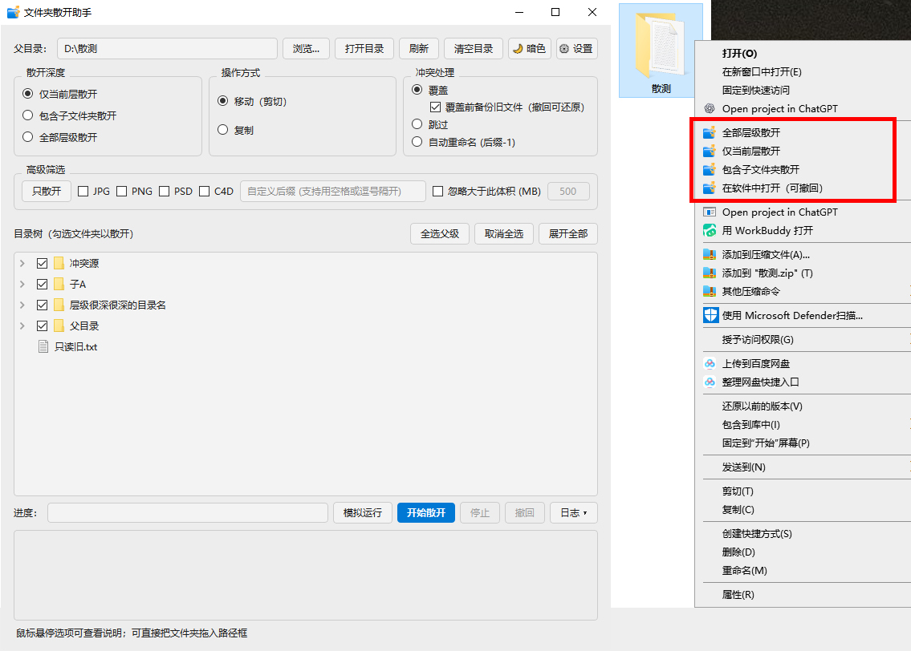
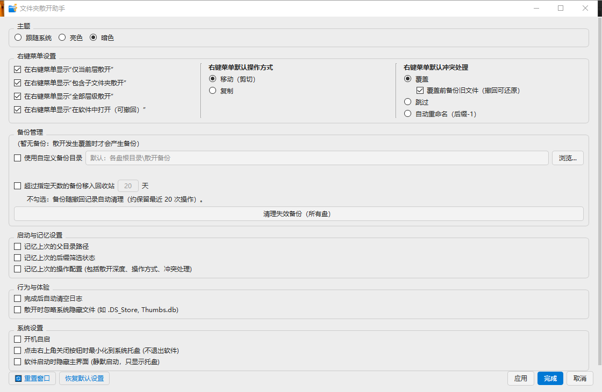
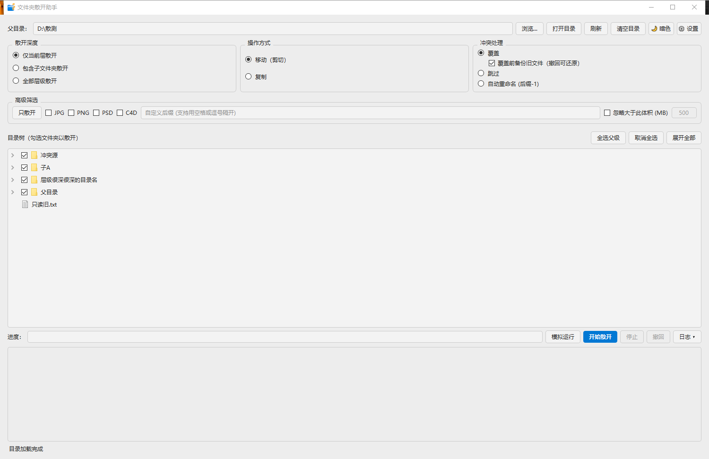

# 文件夹散开助手

> 把套娃文件夹一键摊平，散错了还能原样撤回。

Windows 桌面小工具。从网上下的压缩包、别人发来的资料，解压后常常是「文件夹套文件夹套文件夹」，
找文件要点好几层。这个工具把里面那一层的内容**直接上提到你面前**，还能在资源管理器里右键直接用。

- 语言 / 框架：Python 3 + PyQt6
- 平台：Windows 10 / 11
- 协议：[GPL-3.0](LICENSE)（可以免费用、随便改；改了再发布，也必须开源）
- 形态：源码运行，或用 Nuitka 打包成约 20 MB 的单文件 exe
- 下载：不想装 Python 的话，直接拿 [v1.0.0 免安装版](https://github.com/LLLLOOK/folder-scatter/releases/latest)（Windows 64 位，双击即用）



## 功能

| 功能 | 说明 |
|---|---|
| **三档散开深度** | 只摊开当前层；连子文件夹一起摊开；或把全部层级彻底展平 |
| **移动 / 复制** | 移动是剪切（省时省空间），复制是留一份原件 |
| **冲突处理** | 覆盖 / 跳过 / 自动重命名（加 `-1`），覆盖时可勾选「覆盖前备份旧文件」，撤回能连旧文件一起还原 |
| **按批撤回** | 每次操作压入一批记录，最多留 20 批；关掉软件明天再撤也行（记录存在硬盘上） |
| **撤回还原勾选** | 撤回后目录树的勾选状态也回到散开前那次的样子 |
| **资源管理器右键菜单** | 4 个菜单项直接对文件夹开刀，不用先开软件；静默完成，日志同步回已打开的窗口 |
| **高级筛选** | 按后缀只散开 / 只排除（内置 JPG、PNG、PSD、C4D，可自定义）；忽略大于指定体积的文件；跳过隐藏与系统文件 |
| **模拟运行** | 先干跑一遍，看清楚将要移动哪些文件，再真正开动 |
| **主题** | 深色 / 浅色 / 跟随系统（默认深色） |
| **日志** | 彩色分级、可导出、保留历史与崩溃记录；触顶自动截断（5 万行） |
| **托盘与开机自启** | 关闭最小化到托盘、静默启动（只留托盘图标）、开机自启，都在设置里勾 |

| 设置 | 浅色主题 |
|---|---|
|  |  |

## 安全设计

移动文件是不可逆操作，所以这个工具在「手滑」上做了不少兜底：

- **拒绝系统目录**：Windows、Program Files、用户目录根等一批系统路径直接不让动
- **拒绝盘根**：`D:\` 这种根目录散开会变成自我覆盖，直接拦下
- **链接防穿透**：junction / 符号链接不会被顺着爬进别的目录
- **覆盖先备份**：旧文件先挪到 `<盘>:\散开备份\<批次>\`，同盘改名是瞬时的，几乎不耗时
- **不裸删**：任何保护步骤失败，文件进回收站，不物理删除；只读文件跳过不覆盖
- **撤回记录防伪**：撤回时要读 JSON，来自文件或进程间通信的记录都过两道校验，防止被改坏的文件带着程序去动别的目录
- **跨进程互斥**：右键多开、GUI 同时在跑，也不会两个进程同时搬同一批文件
- **崩溃留痕**：无控制台的 GUI 闪退时，异常写进 `crash.log`，下次启动显示在日志区
- **断点自愈**：散开到一半被强杀，已产出的记录会增量落盘，下次启动自动合成一批可撤回的记录

## 快速开始

需要 Windows 10/11 和 Python 3.9+（开发环境是 3.13）。

```bat
git clone https://github.com/LLLLOOK/folder-scatter.git
cd folder-scatter
pip install -r requirements.txt
python main.py
```

也可以用双击替代最后一步：`运行文件夹散开工具.bat`（用 `pythonw` 启动，不弹黑框）。

### 打包成单文件 exe

```bat
pip install nuitka
打包_Nuitka.bat
```

产物在 `dist_nuitka_plain_onefile\FolderScatter_plain.exe`，约 20 MB，拷给别人双击就能用。
打包后运行时数据改存到 `%APPDATA%\文件夹散开助手\`，exe 所在文件夹保持干净。

## 怎么用

1. 把要处理的文件夹拖进窗口，或点「浏览」选它的**上一级**目录
2. 在目录树里勾选要散开的文件夹（按住 Shift 可以连续勾一串）
3. 选散开深度、操作方式、冲突处理
4. 先点「模拟运行」核对一遍，再点「开始散开」
5. 散错了点「撤回」，原样还原

想用右键菜单：打开「设置」→ 勾上要显示的菜单项 → 完成。之后在资源管理器里右键任意文件夹，
菜单里就有「仅当前层散开 / 包含子文件夹散开 / 全部层级散开 / 在软件中打开（可撤回）」。
（菜单文案改动过的话，程序会自动重写注册表刷新菜单。）

## 数据存在哪

| 内容 | 位置 |
|---|---|
| 撤回历史（开发态） | 项目根目录 `undo_history.json`（含 `.bak` / `.inflight.json` / `_pending.json`） |
| 撤回历史（打包态） | `%APPDATA%\文件夹散开助手\` |
| 覆盖备份 | `<盘>:\散开备份\<批次>\`；盘根不可写时回退到父目录 `.scatter_backup` |
| 崩溃日志 | `crash.log`（与撤回历史同目录） |
| 软件设置 | 注册表 `HKCU\Software\FolderPromoter\FolderPromoter` |
| 右键菜单 | 注册表 `HKCU\Software\Classes\Directory\shell\FolderScatter*` |
| 开机自启 | 注册表 `HKCU\Software\Microsoft\Windows\CurrentVersion\Run` |

卸载 = 删掉程序目录 + 上面这些路径；软件本身不写系统目录、不联网。

## 项目结构

分层 `infra → core / backup / win32 → undo → ui → main`，无循环依赖。

```
main.py              入口：命令行解析、右键静默流程、GUI 启动
infra/               路径常量、文件工具（长路径等）、日志与崩溃钩子
core/                散开调度、单文件搬运、安全防线、跨进程互斥
backup/              备份写入/还原、可信校验、按天清理
undo/                撤回栈、撤回执行线程、撤回记录读写
win32/               右键菜单与开机自启（注册表）、任务栏进度
ui/                  主窗口（按面板拆成 7 个 mixin）、设置、日志、目录树扫描、IPC
tests/               11 个 pytest 脚本，与缺陷编号一一对应
docs/screenshots/    界面截图
```

更细的模块地图和踩坑约定见 `agents.md`，使用说明见 `操作手册.md`，
人工验收清单见 `功能清单与验证方案.html`。

## 测试

```bat
python -m pytest tests\ -q
```

67 项自动化测试，覆盖长路径、同名冲突、覆盖备份与还原、撤回栈、IPC 幂等、
备份清理联动等。每个脚本对应一个具体缺陷编号，回退修复即变红。

## 已知限制

- 只支持 Windows（依赖资源管理器右键菜单、注册表、回收站）
- 右键多选时，「同一次操作 = 一批撤回」靠 10 秒时间窗合并，超时就拆成两批
- 8.3 短文件名场景下，个别「同一个文件」的判断可能不准
- 不建议同时开多个窗口写同一份撤回历史
- 没有云同步、没有多语言界面

## 参与贡献

Issue 和 PR 都欢迎。提 PR 前请先跑一遍 `pytest tests\ -q`，并保持「文件安全不可退让」这条底线：
任何保护步骤失败都必须回退到回收站，不允许静默裸覆盖或物理删除。

## 许可证

本项目基于 [GNU General Public License v3.0](LICENSE) 发布。
Copyright (C) 2026 LLLL

意思是大白话版：

- 你可以免费用、随便改、拿去给别人用
- 但你要是改了再发布（或者拿它做收费产品），**必须把你的源码也按 GPL 开源**
- 分发时必须带上这份协议和版权声明，且不提供任何担保

如果只想自己用、不对外发布，那就没有任何额外义务。
